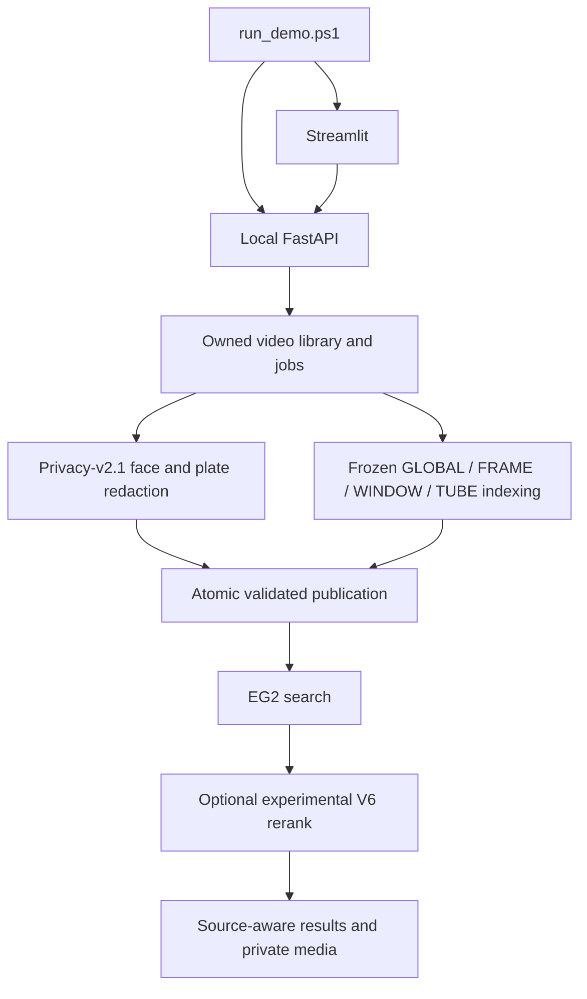

# Scene Search architecture

The canonical entry point is `run_demo.ps1`. It verifies the local installation
and starts a Streamlit UI plus a loopback FastAPI service.

| Responsibility | Source |
|---|---|
| Setup and asset checks | `install.ps1`, `scripts/setup_local_product.ps1`, `demo/product_doctor.py` |
| UI and HTTP client | `demo/streamlit_app.py`, `demo/client.py` |
| API, library and background jobs | `demo/backend.py`, `demo/library.py` |
| Offline geometry and privacy | `demo/product_offline.py`, `demo/product_privacy.py`, `src/privacy/` |
| Product index and mapping | `demo/product_index.py`, `hybrid_v2/product_index.py` |
| Resident FP32 encoder | `demo/product_worker.py`, `demo/product_native_worker.py`, `demo/product_runtime.py` |
| Search, filters and fallback | `demo/product_search.py`, `hybrid_v2/driveevidence_v6_selected.py` |
| Pinned configuration | `configs/product/`, `configs/models/embeddinggemma2.json` |

EG2 is the default. V6 shadow returns EG2 order; active V6 is an explicit
experimental option. Local-evidence failure falls back to exact EG2.
Corrupt GLOBAL/source/privacy contracts block access. V6.1 and V6.2 are not
product modes.

Collections, caches and logs live under `outputs/product/`. Model assets and
three Python environments are local installation data and are not committed.
Private media is published only after validated privacy processing; source
rows retain their own video IDs and actual time bounds.

Older shared modules remain where the frozen runtime or regression tests
import them. The HTML presentation, shared API/infrastructure and Technical
Book are separate from the supported local launcher. Standalone unused
training and experiment drivers are removed; their tracked history is in Git.

See [the product guide](docs/FINAL_LOCAL_PRODUCT_GUIDE.md) for contracts,
limits, API details and acceptance commands.
